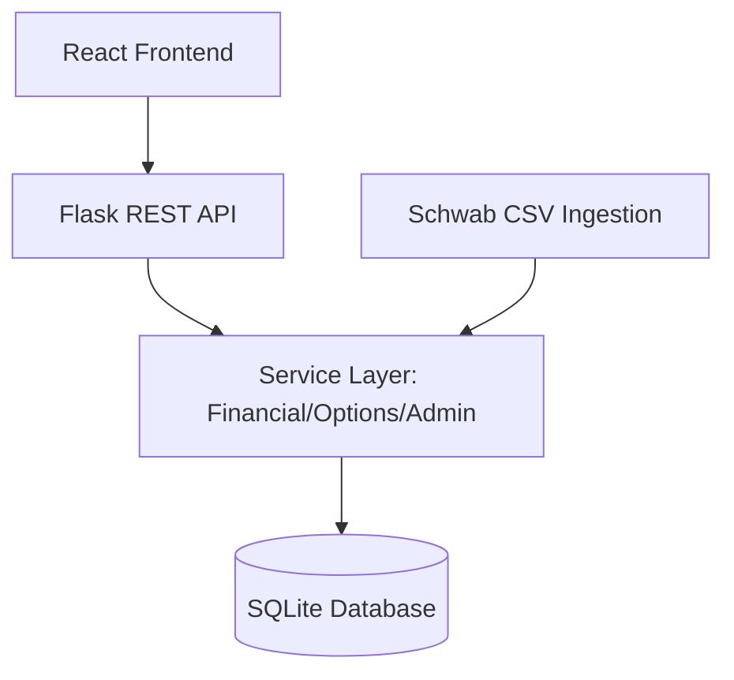

# Parity: Comprehensive Financial Intelligence Suite

**Current Version: v0.3**

> **Transform raw data into financial clarity.** Parity is a local SQLite financial application for monitoring net worth, analyzing cash flow, tracking investment holdings, and reviewing options performance.

Provided as-is without warranty. This software is not financial, tax, or investment advice and may contain errors. Verify all results against official broker statements. The project is not affiliated with or endorsed by any brokerage or data provider named here.

Schwab and Fidelity are named only to describe broker export compatibility. The app uses yfinance for quote lookups; these references describe compatibility and implementation only, not endorsement or verified provider terms.

---

## Version History

| Version | Description | Key Changes |
| :--- | :--- | :--- |
| **v0.3** | **FIFO Accounting & Read-Only Reconciliation** | Matched-event calendar attribution, reconciled display cents, structured issues, Needs Review filters, explicit database migrations, and isolated synthetic tests. Additional mutation validation remains planned. |
| **v0.2** | **Advanced Options & Security** | Schwab Option grouping, Expired trade logic, Password-protected Admin Panel, Hints/Tooltips system. |
| **v0.1** | **Initial Release** | Basic transaction tracking, Income/Balance/Cash-flow reporting, and CSV import base. |

---

## Features at a Glance

<details>
<summary><b>Advanced Options Intelligence</b></summary>

Options analysis with supported broker export formats:
- **Automated Trade Grouping**: Groups opening (STO/BTO) and closing (BTC/STC) legs into Trade Positions using FIFO, intraday ordering, effective broker dates, split adjustments, and transfer diagnostics.
- **Strategy Detection**: Identifies Iron Condors, Spreads, and Single Legs, with payoff diagrams and existing manual-close and Match Trade workflows for missing openings, linked opening legs, and manual-close reconciliation.
- **Expiration Automation**: Parses broker expiration and "As-of" dates. Closed includes confirmed expirations and assignments; the current Expired headline component is staged-only, awaiting broker confirmation. The combined headline includes that staged amount. Unknown transferred basis is flagged, and unmatched closes are excluded from realized P/L.
- **Performance Metrics**: Win rates, ticker P/L, fee breakdowns, payoff views, and monthly/weekly/daily performance filters. Realized results follow individual matched closing dates; display cents reconcile to headline totals. Unrealized Target is a strategy cashflow/profit target, not a live market valuation.
</details>

<details>
<summary><b>Dynamic Analytics Dashboard</b></summary>

A high-fidelity cockpit featuring:
- **Real-time KPI Tracking**: Visibility into Assets, Liabilities, and Total Net Worth, with responsive navigation, lazy-loaded pages, light/dark themes, and a database indicator.
- **Trend Visualization**: Financial history and options performance with bar/curve views, inline values, account/ticker/strategy filters, and calendar selections.
- **Contextual Hints**: Toggleable hints and tooltips, plus a read-only Needs Review list filtered by account and issue type. It shows signed cash, quantity, provenance, and workflow references; informational same-day matches sort after warnings. Partial unmatched cash is distinguished from full source-row cash.
</details>

<details>
<summary><b>Security & System Management</b></summary>

- **Admin Panel**: Password-gated administration and optional database password controls. These application gates do not encrypt SQLite files or provide complete API authentication.
- **Database Maintenance**: Explicit database create/clone/upload/switch/default controls and destructive maintenance. Wiping clears accounts and transaction history while preserving institutions. Opening or inspecting a database does not automatically repair or migrate it.
- **Initial Setup Flow**: Administrator password configuration and explicit database initialization. Missing database reads return HTTP 404 without creating a file; compatible legacy databases open without a migration ledger. Migration preview requires explicit confirmation to apply and first creates a backup including committed WAL data.
</details>

<details>
<summary><b>Holistic Account Management</b></summary>

Support for diverse financial architectures:
- **Multi-Type Support**: Manage checking, savings, investment (brokerage), loans, and credit cards. The Accounts page Import CSV button imports into the selected account and reports validation or duplicate-import errors.
- **Institutional Mapping**: Organize accounts by institution, import supported Schwab and Fidelity option formats, normalize broker descriptions, and preserve legitimate repeated same-file executions while handling duplicate imports. Stock transfers and incomplete-basis flags are supported.
- **Empty State Guidance**: Empty views and error/retry guidance. The frontend requests the configured default database on page load; there is no automatic database setup wizard. Keep financial databases and exports in a private local location; Git ignore rules do not control cloud-folder synchronization.
</details>

<details>
<summary><b>Professional Financial Reporting</b></summary>

Standardized accounting views generated automatically:
- **Income Statement**: Categorical breakdown of profit and loss.
- **Balance Sheet**: Comprehensive asset and liability audit.
- **Cash Flow Statement**: Segmented into Operating, Investing, and Financing activities.
</details>

---

## Roadmap: AI Analytics (Planned)

A two-tier **AI Insights Engine** remains planned. Mutation hardening, resolution history, a duplicate-warning dismissal button, reversible transaction ignoring, and the Confirmed Realized redesign are also pending:
1. **Rule-Based Analytics**: Planned local heuristics for win rates, risk concentration, and fee drag; not yet implemented.
2. **LLM Narrative Layer**: Planned optional summaries; no AI or new market-data provider has been selected. Existing yfinance quote/company lookups contact external services; provider terms and capabilities remain unverified.

---

## The Tech Stack

| Layer | Technologies |
| :--- | :--- |
| **Frontend** | React 19, TypeScript, Vite 8, Tailwind CSS, Recharts, Lucide React |
| **Backend** | Python 3.12 (validated runtime), Flask, Flask-CORS, yfinance |
| **Database** | SQLite3 (Persistent, local-first storage) |
| **Data Processing** | Pandas 2.2.3, regex parsing, SQL aggregation, Decimal FIFO calculations, immutable matched-event records |

---

## Project Architecture



### Detailed Structure

- `models/`: Schema, database registry/selection, missing-file guards, read-only inspection, and explicitly confirmed migrations with backups; no startup migration.
- `services/`: 
    - `options.py`: Portfolio assembly and existing mutations; options_fifo.py handles in-memory FIFO, option_events.py records matched events, and option_issues.py / option_issue_list.py provide stable diagnostics and read-only filtering.
    - `data_import.py`: Supported broker date/action parsing, chronological CSV ingestion, account mapping, and import provenance.
    - `crud.py`: Transaction/import lifecycle, duplicate handling, explicit repair previews, and wiping. Public tests run through python -B scripts/test_isolated.py with disposable storage and mocked/network-blocked quotes.
- `frontend/src/pages/`:
    - `AdminPage.tsx`: Database management, defaults, password controls, and destructive maintenance.
    - `OptionsPage.tsx`: Performance charts, payoff views, manual-close/match dialogs, and the read-only Needs Review list. Delete transaction removes an unmatched close and changes unmatched cash, net cash, win rate, and closed count; duplicate-warning dismissal only changes visibility. No new resolution buttons are present.

---

## Getting Started

### 1. Environment Preparation
Use **Python 3.12** (validated) and **Node.js ^20.19.0 or >=22.12.0** for the current Vite installation. Only for an empty installation, run python -m models.schema before starting the server; existing compatible databases require no forced migration. Inspect/preview maintenance with python -m models.schema --status --db finance.db or --migrate --db finance.db; apply only after review with --confirm. The Flask entry point is a development server. Run the invented-data public suite with python -B scripts/test_isolated.py. The runner copies source into disposable storage and blocks network quotes. Accounting AST checks detect changes to calculation statements; review an intentional accounting change before updating those source fingerprints.

### 2. Backend Installation
```bash
pip install -r requirements.txt
python server.py
```

### 3. Frontend Installation
```bash
cd frontend
npm install
npm run dev
```

---

## API Reference (Internal)

| Endpoint | Method | Description |
| :--- | :--- | :--- |
| `/api/options` | `GET` | Portfolio, calendar performance, legacy warnings, and structured issues. The separate GET /api/options/issues supports comma-separated account_ids/type filters and as_of_date; invalid filters return 400, missing databases return 404. |
| `/api/admin/verify` | `POST` | Password verification for admin access. |
| `/api/wipe` | `POST` | Admin-password-verified deletion of account and transaction data; preserves institutions. |
| `/api/dashboard` | `GET` | Summary KPIs and historical trend data. |

---

## License
Distributed under the **MIT License**. See [LICENSE](LICENSE).

---
**Parity** — A local financial tracking application.
